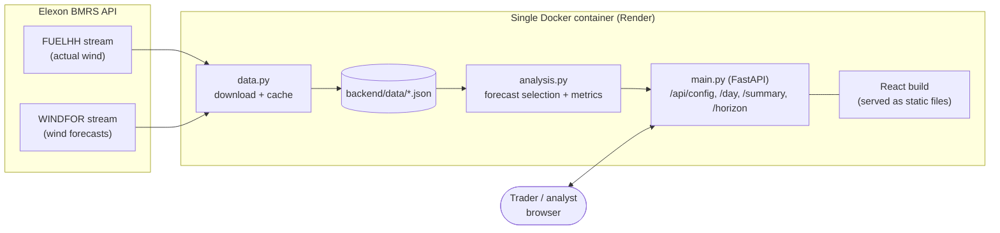
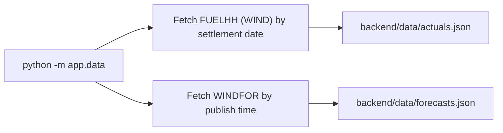
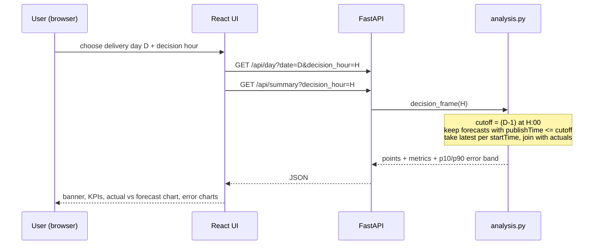

# Wind forecast accuracy portal (UK day-ahead desk)

Web app that shows, for each January-2026 day-ahead purchase decision:
1. the **latest wind forecast available at decision time** (default 09:00 UK on D-1, changeable in the UI), and
2. **how accurate** those forecasts are (MAE, RMSE, bias, error by day / hour of day / forecast horizon) plus a likely-range band.

Data: national wind only, from Elexon BMRS: actuals `FUELHH` (fuelType WIND), forecasts `WINDFOR`. Nothing else.

**Live app:** https://aero-q1l4.onrender.com/
(Hosted on Render's free tier: if idle it sleeps, so the first load can take 30-60 seconds.)

## How it works (the one rule)
For every half-hour of delivery day D, we take the forecast with the **latest `publishTime` that is <= decision time on D-1**
and compare it to the actual. No future information is used. Error = forecast - actual (positive = over-forecast).
"Decisions in January 2026" = decisions on 1-31 Jan, i.e. delivery days 2 Jan - 1 Feb. All times are UTC (= UK time in January).

## Architecture



| Layer | Tech | Responsibility |
|---|---|---|
| Data | Python, `requests`, pandas | Download Jan-2026 data from Elexon in small date windows (auto-split on failure), cache as JSON, load as DataFrames |
| Analysis | pandas, numpy | Pick the latest forecast available at decision time, compute error metrics and the likely-range band |
| API | FastAPI | Thin JSON endpoints over the analysis functions; also serves the built React app |
| UI | React, Vite, Recharts | Controls, KPI cards, charts |
| Packaging | Docker (multi-stage) | Stage 1 builds React, stage 2 runs Python and serves API + UI from one container |

### Design choices
- **One container, one URL.** FastAPI serves the built React files, so there is no CORS and only one thing to deploy.
- **Data is cached in the repo** (`backend/data/*.json`), so the deployed app never depends on Elexon being up.
- **All maths in `analysis.py`**, kept separate from the web layer, so it is easy to test and review.
- **Decision time is a parameter**, not hard-coded, so the desk can see how results change if they decide earlier or later.

## Workflow

### 1. Data pipeline (one-off)


### 2. What happens when a user picks a delivery day and decision time


### 3. What the dashboard shows
1. **Banner**: which forecast (publish time) was the latest at decision time, expected MWh, and the likely range.
2. **KPI cards**: forecast vs actual energy, MAE, RMSE, bias for the day, MAE for the whole month.
3. **Actual vs forecast chart** with a shaded likely-range band (10th-90th percentile of this month's errors).
4. **Daily MAE** across January: which days were hard to forecast.
5. **MAE by hour of day**: which parts of the day are riskiest.
6. **Accuracy vs forecast horizon**: error of every forecast by hours ahead of delivery (value of a fresher forecast).

### Metrics
| Metric | Meaning |
|---|---|
| MAE | Average absolute error in MW |
| RMSE | Like MAE but penalises big misses more |
| Bias | Average signed error (+ = over-forecast, risk of under-buying) |
| MAPE | Average % error (half-hours with zero actual are skipped) |
| P90 abs error | 90% of half-hours had an error below this |
| Likely range | forecast minus the 90th / 10th percentile of historical errors |

The range band is computed from the same January data it is shown on (in-sample), so treat it as indicative.

## API

| Endpoint | Description |
|---|---|
| `GET /api/config` | List of delivery days and default decision hour |
| `GET /api/day?date=YYYY-MM-DD&decision_hour=9` | 48 half-hourly points (actual, forecast, band), day metrics, forecast publish time |
| `GET /api/summary?decision_hour=9` | Overall metrics, daily metrics, metrics by hour of day, error percentiles |
| `GET /api/horizon` | MAE/RMSE by forecast horizon (0-48 h) |

## Files
```
backend/app/data.py       download + load Elexon data (cached to backend/data/*.json); SAMPLE_DATA=1 gives synthetic data
backend/app/analysis.py   decision-time forecast selection + metrics
backend/app/main.py       FastAPI: /api/config, /api/day, /api/summary, /api/horizon (+ serves the built UI)
backend/tests/            pytest (look-ahead check, metrics, endpoints)
frontend/src/App.jsx      the whole React UI (Recharts)
frontend/src/styles.css   styling
Dockerfile                builds UI, then runs API + UI in one container
docker-compose.yml        local Docker run
heroku.yml                optional Heroku container deploy
```

## Run locally
**Docker**
```
docker compose up --build        # http://localhost:8000
```

**Without Docker**
```
cd backend && pip install -r requirements.txt
python -m app.data               # downloads real data once (about 1-2 min)
uvicorn app.main:app --port 8000

cd frontend && npm install && npm run dev      # http://localhost:5173
```
Offline demo with synthetic data: `SAMPLE_DATA=1 uvicorn app.main:app`.
Tests: `cd backend && python -m pytest`.

## Deployment (Render)
1. Run `python -m app.data` in `backend/` and commit `backend/data/*.json`.
2. Push the repo to GitHub.
3. On Render: New > Web Service > select the repo > Runtime **Docker** > Instance type Free > Create.

Render builds the `Dockerfile` and injects `PORT`, which the container reads. (`heroku.yml` is included for Heroku users but is not used for the live app.)

## Assumptions and limitations
- Decision time defaults to 09:00 UK on D-1. This is an assumption, and the UI lets you change it.
- "Decisions in January 2026" is interpreted as delivery days 2 Jan - 1 Feb.
- Only national wind is used, with no demand data, so the app shows wind uncertainty, not the exact MWh to buy.
- Errors are in MW per half-hour; energy figures convert MW to MWh by dividing by 2.
  

