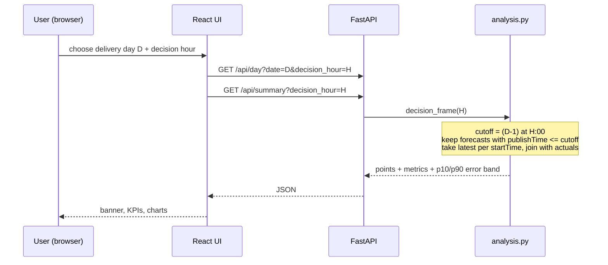

# Wind forecast accuracy portal (UK day-ahead desk)

A web app for a power-trading desk that buys energy a day ahead. For every January-2026 purchase decision it shows the **latest wind forecast available at decision time** and **how accurate those forecasts have been**.

**Live app:** https://aero-q1l4.onrender.com/
(Render free tier: if idle the app sleeps, so the first load can take 30-60 seconds.)

## Table of contents

1. [At a glance](#at-a-glance)
2. [Architecture](#architecture)
3. [Quick start](#quick-start)
4. [Configuration](#configuration)
5. [How a forecast is selected](#how-a-forecast-is-selected)
6. [Technology choices and why](#technology-choices-and-why)
7. [Limitations, honestly](#limitations-honestly)
8. [API reference](#api-reference)
9. [Repository layout](#repository-layout)

---

## At a glance

| | |
|---|---|
| **Question answered** | "At the time I must decide, what does the wind forecast say, and how far off is it usually?" |
| **Data** | National wind only, from Elexon BMRS: actuals `FUELHH` (fuelType WIND), forecasts `WINDFOR` |
| **Period** | Decisions made 1-31 Jan 2026, i.e. delivery days 2 Jan - 1 Feb 2026 |
| **Decision time** | 09:00 UK on D-1 by default, changeable in the UI |
| **Outputs** | Forecast vs actual chart with likely-range band, MAE / RMSE / bias, error by day, by hour of day, and by forecast horizon |
| **Delivery** | One Docker container serving API + UI, deployed on Render |

## Architecture


| Layer | Responsibility |
|---|---|
| Data (`data.py`) | Download Jan-2026 data from Elexon in small windows (auto-splits on failure), cache as JSON, load as DataFrames |
| Analysis (`analysis.py`) | Pick the latest forecast available at decision time, compute error metrics and the likely-range band |
| API (`main.py`) | Thin JSON endpoints over the analysis functions; also serves the built React app |
| UI (`App.jsx`) | Controls, KPI cards, charts |
| Packaging (`Dockerfile`) | Stage 1 builds React, stage 2 runs Python and serves API + UI together |

**Design choices**
- One container and one URL: no CORS, one thing to deploy.
- Data is cached in the repo (`backend/data/*.json`), so the deployed app never depends on Elexon being up.
- All maths lives in `analysis.py`, separate from the web layer, so it is easy to test.
- Decision time is a parameter, so the desk can see how results change if they decide earlier or later.

**Request flow**



## Quick start

**1. Download the data (once)**
```
cd backend
pip install -r requirements.txt
python -m app.data            # about 1-2 minutes, writes backend/data/actuals.json and forecasts.json
```

**2a. Run with Docker**
```
docker compose up --build     # http://localhost:8000
```

**2b. Run without Docker** (two terminals)
```
cd backend  && uvicorn app.main:app --port 8000
cd frontend && npm install && npm run dev      # http://localhost:5173
```

**Offline demo with synthetic data:** `SAMPLE_DATA=1 uvicorn app.main:app`
**Tests:** `cd backend && python -m pytest`

**Deploy on Render**
1. Commit `backend/data/*.json` and push the repo to GitHub.
2. Render > New > Web Service > pick the repo > Runtime **Docker** > Instance type Free > Create.

Render builds the `Dockerfile` and injects `PORT`, which the container reads.

## Configuration

| Setting | Where | Default | Purpose |
|---|---|---|---|
| Delivery day | UI dropdown | 15 Jan 2026 | Which day to inspect |
| Decision hour | UI dropdown / `decision_hour` query param | 09 (UK time, day before) | Cut-off for which forecast is "available" |
| `PORT` | env var | 8000 | Port the server listens on (Render sets this) |
| `SAMPLE_DATA` | env var | unset | `1` = use synthetic data instead of Elexon files |
| `DATA_DIR` | env var | `backend/data` | Where the cached JSON files live |
| `FIRST_DELIVERY` / `LAST_DELIVERY` | `backend/app/data.py` | 2 Jan / 1 Feb 2026 | Delivery window analysed |

## How a forecast is selected

For every half-hour of delivery day D, take the forecast with the **latest `publishTime` that is <= the decision time on D-1**, and compare it with the actual. No future information is used (a test checks this). Error = forecast - actual, so a positive error means over-forecast. All times are UTC, which equals UK time in January.

| Metric | Meaning |
|---|---|
| MAE | Average absolute error in MW |
| RMSE | Like MAE but penalises big misses more |
| Bias | Average signed error (+ = over-forecast, risk of under-buying) |
| MAPE | Average % error (half-hours with zero actual are skipped) |
| P90 abs error | 90% of half-hours had an error below this |
| Likely range | Forecast minus the 90th / 10th percentile of historical errors |

**What the dashboard shows**
1. Banner: publish time of the forecast used, expected MWh, likely range.
2. KPI cards: forecast vs actual energy, MAE, RMSE, bias, month MAE.
3. Actual vs forecast chart with the shaded likely-range band.
4. Daily MAE across January: which days were hard.
5. MAE by hour of day: which parts of the day are riskiest.
6. Accuracy vs forecast horizon: error by hours ahead of delivery (value of a fresher forecast).

## Technology choices and why

| Area | Choice | Why |
|---|---|---|
| Language (backend) | Python 3.11 | Best fit for data work; same language for fetching, analysis and API |
| API framework | FastAPI 0.115 + Uvicorn | Small, fast to write, typed query params, automatic validation |
| Data processing | pandas 2.2 + numpy | Time-series joins and group-bys in a few lines |
| HTTP client | requests | Simple, reliable for the Elexon REST API |
| Frontend | React 18 | Component model fits KPI cards + several charts |
| Build tool | Vite 5 | Fast dev server and a simple production build |
| Charts | Recharts 2 | Declarative charts, supports the shaded range band |
| Tests | pytest + httpx | Checks look-ahead safety, metrics and endpoints |
| Packaging | Docker (multi-stage, Node 20 + Python 3.11) | One reproducible image for API + UI |
| Hosting | Render (Docker web service, free tier) | Runs the Dockerfile as is, no extra config |
| Data source | Elexon BMRS open API | Official GB wind actuals and forecasts, no API key needed |
| Storage | JSON files in the repo | No database needed for one month of data; deploys with no external dependency |

## Limitations, honestly

- **Decision time is an assumption.** 09:00 UK on D-1 is a typical day-ahead gate, but the brief does not fix it; the UI lets you change it.
- **"Decisions in January" is interpreted** as delivery days 2 Jan - 1 Feb.
- **The likely range is in-sample.** It is built from the same January errors it is displayed on, so treat it as indicative, not a guarantee.
- **One month only.** Winter wind behaviour may not generalise to other seasons.
- **Wind only.** There is no demand or price data, so the app shows wind uncertainty, not the exact MWh to buy.
- **Free hosting sleeps.** The first request after idle is slow.
- **Forecast vintages.** If Elexon had no forecast published before the cut-off for some half-hours, those half-hours show no forecast and are skipped in the metrics.

## API reference

| Endpoint | Description |
|---|---|
| `GET /api/config` | Delivery days and default decision hour |
| `GET /api/day?date=YYYY-MM-DD&decision_hour=9` | 48 half-hourly points (actual, forecast, band), day metrics, forecast publish time, energy totals |
| `GET /api/summary?decision_hour=9` | Overall metrics, daily metrics, metrics by hour of day, error percentiles |
| `GET /api/horizon` | MAE / RMSE by forecast horizon (0-48 h) |

Errors: `404` for a date outside the window, `422` for an invalid `decision_hour` (must be 0-23).

## Repository layout

```
.
├── backend/
│   ├── app/
│   │   ├── data.py          download + load Elexon data (cached JSON); SAMPLE_DATA=1 for synthetic data
│   │   ├── analysis.py      decision-time forecast selection + metrics
│   │   └── main.py          FastAPI routes (+ serves the built UI)
│   ├── data/                actuals.json, forecasts.json (committed)
│   ├── tests/               pytest: look-ahead check, metrics, endpoints
│   └── requirements.txt
├── frontend/
│   ├── src/App.jsx          the whole React UI
│   ├── src/styles.css
│   ├── package.json
│   └── vite.config.js       dev proxy: /api -> localhost:8000
├── Dockerfile               builds UI, then runs API + UI in one container
├── docker-compose.yml       local Docker run
├── heroku.yml               optional Heroku container deploy (not used for the live app)
└── README.md
```

